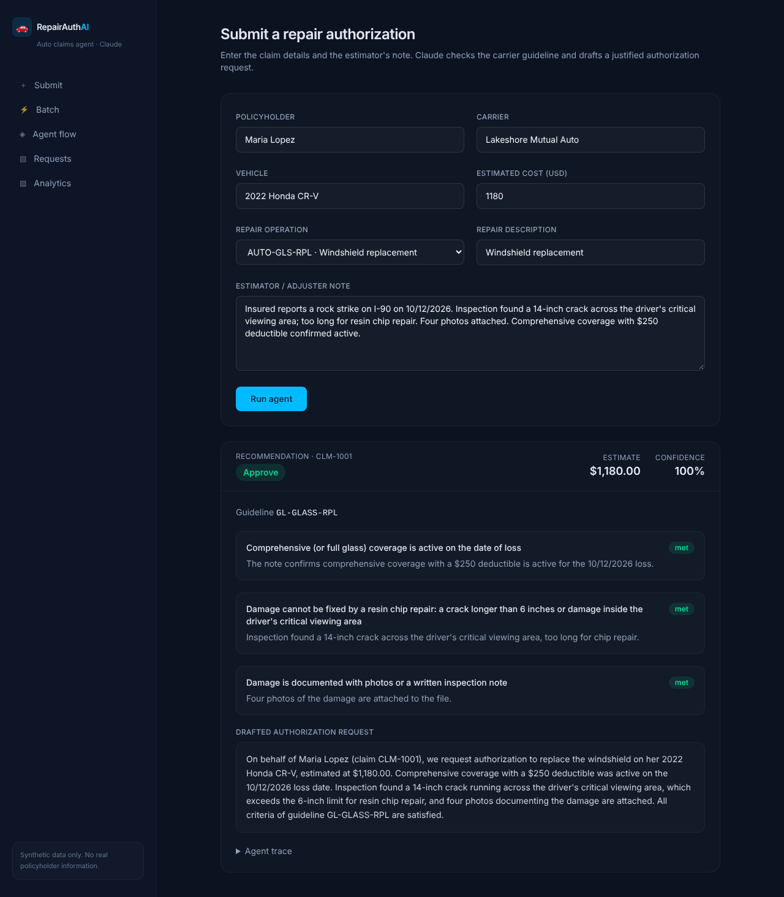
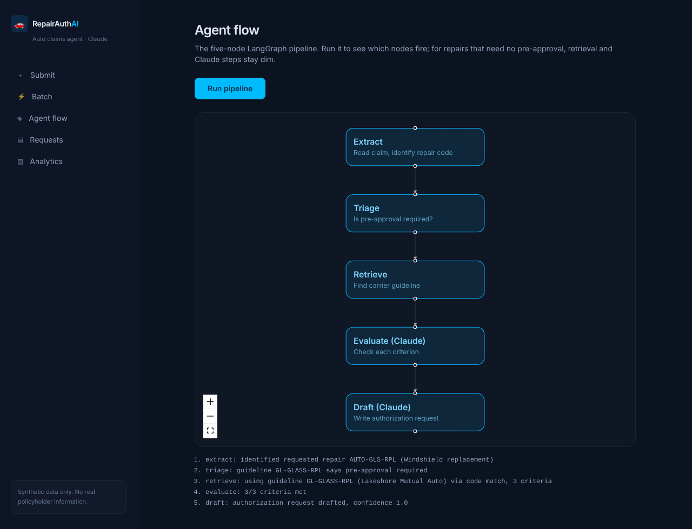
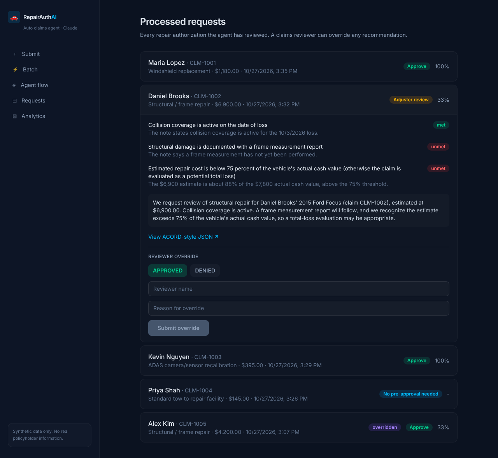
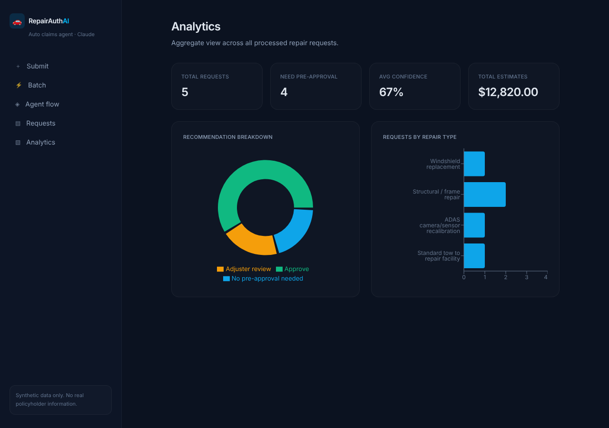

# 🚗 Auto Repair Authorization Assistant

> A Claude-powered AI agent that helps auto body shops and insurance claims desks get **carrier pre-approval for repairs**. A staffer submits the claim, the repair being requested and the estimator's note. A LangGraph agent decides whether the carrier requires pre-approval, finds the carrier's guideline, checks the claim against each criterion with Claude, and drafts a justified authorization request with a confidence score.


-D97757)


> 🧪 **Self-learning proof of concept** built to explore Claude for P&C insurance. Phase 1 is complete; Phase 2 is starting (see [Roadmap](#roadmap)).

---

## What It Does

In auto insurance, many repairs (windshield replacement, structural/frame work, ADAS sensor recalibration, rental extensions) need **carrier approval before the shop starts work**. Each carrier publishes guidelines listing the criteria. Shops and desk adjusters spend hours matching estimates, photos and reports to those rules, and missing documentation leads to pended claims, supplements and delays for the policyholder.

This tool automates the first draft. A staffer enters the claim and the agent:

1. **Extracts** the requested repair operation
2. **Triages** whether the carrier requires pre-approval; if not, it stops here
3. **Retrieves** the governing carrier guideline
4. **Evaluates** the claim against each criterion with **Claude**: met, unmet or uncertain, with a one-sentence justification
5. **Drafts** an authorization request with **Claude** and scores its confidence

The result is a recommendation (**Approve**, **Adjuster review** or **No pre-approval needed**) that a human adjuster can override.

---

## Screenshots

**Recommendation view: per-criterion reasoning and the drafted request**


**Agent flow: the five-node LangGraph pipeline, lit up as it runs**


**Request history: reviewer override and ACORD export**


**Analytics: recommendations, repair types and estimate totals**


*Screenshots use synthetic sample data.*

---

## The Agent

Five discrete LangGraph nodes, kept separate so the pipeline is easy to inspect, test and extend:

```
extract → triage ──(no pre-approval)──→ END
               └──(pre-approval required)──→ retrieve → evaluate (Claude) → draft (Claude) → END
```

The branch after triage is a real short-circuit: a routine tow skips retrieval, evaluation and drafting, so it makes **zero** Claude calls.

**How Claude is used**
- **Structured outputs** (JSON schema) guarantee every criterion check returns valid `{status, justification}`, with no fragile text parsing
- Criteria are checked **in parallel** to keep latency low
- Model is configurable (`claude-sonnet-5-5` by default); low effort for simple checks, medium for drafting
- Every failure (rate limits, outages, refusals, truncation) degrades safely to "uncertain, needs manual review", and a request with no matching guideline is **never auto-approved**
- The adjuster note is treated as untrusted evidence, so instructions hidden in it are ignored and flagged

---

## Tech Stack

- **LangGraph + FastAPI**: agent orchestration and REST API
- **Claude (Anthropic API)**: criterion evaluation, request drafting, reconsideration letters and guideline PDF structuring
- **PostgreSQL + pgvector**: request history, guidelines and optional embeddings in one database
- **ACORD-inspired data model**: policyholder, vehicle, policy coverages, loss and repair request
- **Next.js 16 + React 19 + Tailwind 4**: Submit, Batch, Agent Flow, Requests and Analytics views
- **Recharts + React Flow**: analytics charts and the live agent-pipeline view
- **pytest**: 25 unit and API tests with Claude and the database mocked
- **Docker / Docker Compose**: local database and API image

---

## Architecture

```
Next.js UI ──HTTP──> FastAPI ──> LangGraph agent ──> Claude (Anthropic API)
                        │               │
                        └──> Postgres ◄─┘
                             ├─ requests   (decisions + full agent trace + reviewer overrides)
                             └─ guidelines (carrier rules + optional pgvector embeddings)
```

The guideline layer is isolated from the agent, so carrier guidelines ingested from PDFs flow into the same table the agent already reads, with no code changes.

---

## Data & Safety

All claims, policyholders, vehicles and carrier guidelines are **synthetic**. "Lakeshore Mutual Auto" is a fictional carrier. The agent produces **recommendations only**; a human adjuster makes the final decision and every override is recorded for audit.

---

## Running Locally

**Prerequisites:** Python 3.12, Node 20.9+, Docker Desktop, and an Anthropic API key from [platform.claude.com](https://platform.claude.com).

```bash
# Database (Postgres + pgvector)
docker compose up -d

# Backend
cd backend
python -m venv venv
# Windows: .\venv\Scripts\Activate.ps1   |   macOS/Linux: source venv/bin/activate
pip install -r requirements-dev.txt
cp .env.example .env                 # Windows: copy .env.example .env   → add ANTHROPIC_API_KEY
python -m db.init_db                 # enable pgvector, create tables, seed guidelines
python run_agent.py all              # watch the agent on 4 sample claims
uvicorn api.main:app --reload --port 8000

# Frontend (separate terminal)
cd frontend
npm install
npm run dev                          # http://localhost:3000
```

Run the tests (no API key or database needed):

```bash
cd backend && pytest
```

### Sample scenarios

| Claim | Repair | Expected outcome |
|---|---|---|
| Maria Lopez, 2022 Honda CR-V | Windshield replacement | All criteria met → **Approve** |
| Daniel Brooks, 2015 Ford Focus | Structural / frame repair | No measurement report; estimate is 88% of vehicle value → **Adjuster review** |
| Priya Shah, 2019 Tesla Model 3 | Standard tow | **No pre-approval needed** (short-circuit) |
| Kevin Nguyen, 2023 Toyota RAV4 | ADAS recalibration | All criteria met → **Approve** |

---

## Advanced Capabilities

- **Reconsideration agent**: when criteria are unmet or uncertain, Claude drafts a reconsideration letter from the *stored* result. It leans on the evidence that exists, acknowledges the gaps honestly, and doesn't re-run the agent.
- **Human-in-the-loop override**: an adjuster can approve or deny any recommendation with a reason; the override is saved and shown as an audit badge. Set `REVIEWER_API_KEY` to require a reviewer key.
- **Batch mode**: processes a queue of requests in one call, for example a shop's end-of-day submissions; each item reports success or its own error.
- **ACORD-inspired export**: `GET /api/requests/{id}/acord` returns each decision in insurance-industry vocabulary, as a starting point for carrier integrations.
- **Guideline PDF ingestion**: Claude turns a carrier-guideline PDF into structured criteria and loads it into the database; the new guideline is usable immediately.
- **Optional semantic search**: pgvector similarity search finds the closest guideline when a repair code isn't an exact match.

---

## Designed This Way on Purpose

- **Five discrete nodes**: new steps (such as the reconsideration agent) slot in without disturbing the pipeline, and each node is unit-tested on its own.
- **One Claude gateway** (`agent/llm.py`): model choice, limits and error handling live in one place.
- **One decision function** (`api/decisions.py`): the UI, analytics and ACORD export can never disagree about a recommendation.
- **Light runtime**: the API needs no torch; embeddings are an optional add-on.

---

## Roadmap

**Phase 1 (done):** five-node agent, Claude structured outputs, FastAPI, Postgres + pgvector, Next.js dashboard, reconsideration letters, reviewer override, batch mode, ACORD-inspired export, PDF ingestion and unit tests.

**Phase 2 (starting):**
- Authentication and roles (shop vs. adjuster)
- Claude vision for damage photos and frame-measurement reports
- Prompt caching and batch processing to reduce Claude cost
- Deterministic total-loss check (estimate vs. actual cash value)
- Cloud deployment (API, database, UI) with a live demo

---
Built by **[Deepavalli S](https://github.com/Deepavalli)**: Engineering Manager · Java, Spring Boot & Microservices · Claude Certified (Anthropic)
